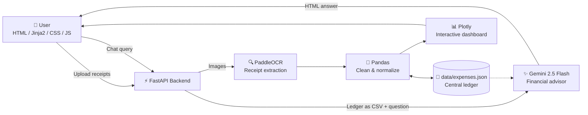

<div align="center">

# 🤖 AI CFO

### Turn a pile of receipts into a smart financial dashboard, and chat with your money.

**Snap. Upload. Understand.** AI CFO reads your receipts with OCR, visualizes your spending, and lets you ask an AI advisor questions about your own ledger.

<br>

[](https://www.python.org/)
[](https://fastapi.tiangolo.com/)
[](https://github.com/PaddlePaddle/PaddleOCR)
[](https://ai.google.dev/)
[](https://plotly.com/)
[](#-license)

<!-- Add your live link once deployed, e.g.:
[🚀 Live Demo](https://your-app.onrender.com) · -->
[🐛 Report a Bug](https://github.com/kg0420/AI-CFO/issues) · [✨ Request a Feature](https://github.com/kg0420/AI-CFO/issues)

</div>

---

## 📑 Table of Contents

- [Overview](#-overview)
- [Features](#-features)
- [How It Works](#-how-it-works)
- [Tech Stack](#-tech-stack)
- [Quick Start](#-quick-start)
- [API Reference](#-api-reference)
- [Ask the AI CFO](#-ask-the-ai-cfo)
- [Project Structure](#-project-structure)
- [Authentication & Security](#-authentication--security)
- [Deployment](#-deployment-on-render)
- [Roadmap](#-roadmap)
- [Contributing](#-contributing)
- [License](#-license)

---

## 🌟 Overview

Managing expenses usually means shoeboxes of receipts and spreadsheets nobody wants to update. **AI CFO** removes that friction.

Upload receipt images and **PaddleOCR** pulls out the merchant, date, tax, totals and line items. **Pandas** cleans the data and **Plotly** turns it into interactive charts. A built-in advisor powered by **Google Gemini 2.5 Flash** answers questions grounded in *your* actual ledger.

| 📥 Input | ⚙️ Processing | 📤 Output |
| :--- | :--- | :--- |
| Receipt images or manual entries | OCR → normalization → analytics | Dashboards and AI-driven insights |

---

## ✨ Features

### 📄 Automated Receipt Processing

- **Batch upload:** drop in multiple receipts at once.
- **Concurrent OCR:** `asyncio` and `ThreadPoolExecutor` process receipts in parallel, so big batches finish faster.
- **Smart extraction** of the fields that matter:

| Field | Field | Field |
| :---: | :---: | :---: |
| 🏪 Merchant | 📅 Date | 💵 Base amount |
| 🧾 Tax | 💰 Grand total | 🛒 Line items |

### 📊 Interactive Financial Analytics

Extracted data is normalized with **Pandas** and visualized with **Plotly**, and every chart is interactive (hover, zoom, filter).

| Chart | What it shows |
| :--- | :--- |
| 🍩 **Donut** | Expense breakdown by category |
| 📊 **Bar** | Total spending by top vendors |
| 📈 **Line** | Spending trends over time |
| 🥞 **Stacked bar** | Tax vs. base amount by vendor |
| 🟩 **Treemap** | Total Spend → Category → Vendor |
| 🥧 **Pie** | OCR-extracted vs. manually entered expenses |

### 💬 AI Financial Advisor

Ask questions in plain English and get answers based on your real data.

- **Context-aware:** the ledger is converted into a lightweight CSV and sent to Gemini as context.
- **Conversational:** chat directly from the dashboard.
- **Actionable:** concise insights, not generic advice.
- **Clean rendering:** responses are formatted as HTML for the dashboard.

### ✍️ Human-in-the-Loop Data Entry

OCR can struggle with blurry, crumpled or incomplete receipts. When it does, you can add an expense manually:

`Merchant` · `Date` · `Amount` · `Category` · `Description`

Manual entries are normalized into the same structure as OCR results, so charts and the AI advisor treat them identically.

### 🔐 Built-in Authentication

Register and log in with **bcrypt**-hashed passwords and **JWT** sessions stored in HTTP-only cookies.

---

## 🏗️ How It Works



1. **Upload:** receipts go to the FastAPI backend.
2. **Extract:** PaddleOCR reads each receipt concurrently.
3. **Normalize:** Pandas converts everything into one consistent ledger.
4. **Visualize:** Plotly renders the interactive dashboard.
5. **Ask:** Gemini answers questions using your ledger as context.

---

## 🛠️ Tech Stack

| Layer | Technology | Purpose |
| :--- | :--- | :--- |
| **Language** | Python | Core programming language |
| **Backend** | FastAPI | API and web server |
| **OCR** | PaddleOCR | Receipt text extraction |
| **AI** | Google Gemini 2.5 Flash | Financial analysis and chat |
| **Data** | Pandas | Processing and normalization |
| **Visualization** | Plotly | Interactive charts |
| **Templating** | Jinja2 | HTML rendering |
| **Auth & DB** | SQLAlchemy · SQLite | User accounts |
| **Security** | bcrypt · PyJWT | Password hashing and tokens |
| **Frontend** | HTML · CSS · JavaScript | User interface |

---

## 🚀 Quick Start

### Prerequisites

- Python **3.9, 3.10 or 3.11**
- A **Google Gemini API key** from [Google AI Studio](https://aistudio.google.com/)
- Git
- *(Windows)* C++ Build Tools, if your PaddleOCR/PaddlePaddle setup requires them

### 1. Clone the repository

```bash
git clone https://github.com/kg0420/AI-CFO.git
cd AI-CFO
```

### 2. Create a virtual environment

<details open>
<summary><b>🪟 Windows</b></summary>

```bash
python -m venv venv
venv\Scripts\activate
```

</details>

<details>
<summary><b>🍎 macOS / 🐧 Linux</b></summary>

```bash
python3 -m venv venv
source venv/bin/activate
```

</details>

### 3. Install dependencies

```bash
pip install fastapi uvicorn pandas plotly google-genai python-dotenv python-multipart jinja2 sqlalchemy PyJWT bcrypt
```

Then install PaddleOCR (it needs PaddlePaddle as its backend):

```bash
python -m pip install paddlepaddle
pip install "paddleocr>=2.0.1"
```

> 💡 **Tip:** PaddlePaddle installation varies by OS, Python version, CPU architecture and CPU/GPU choice. If the command above fails, follow the official [PaddleOCR installation guide](https://github.com/PaddlePaddle/PaddleOCR).

### 4. Configure environment variables

Create a `.env` file in the project root:

```env
GEMINI_API_KEY=your_actual_gemini_api_key
SECRET_KEY=your_long_random_secret_key
```

> ⚠️ **Never commit `.env` to GitHub.** Make sure your `.gitignore` includes:
>
> ```text
> .env
> venv/
> .venv/
> __pycache__/
> *.pyc
> temp_uploads/
> ```

### 5. Run the app

```bash
uvicorn main:app --reload
```

Open **http://localhost:8000** and you're in. 🎉

---

## 🌐 API Reference

| Method | Endpoint | Description |
| :---: | :--- | :--- |
| `GET` | `/` | Main dashboard and expense interface |
| `GET` | `/auth` | Authentication page |
| `POST` | `/register` | Create a new user account |
| `POST` | `/login` | Authenticate and create a JWT session |
| `GET` | `/logout` | Log the current user out |
| `POST` | `/generate-report` | Process uploaded receipts and build the dashboard |
| `POST` | `/add-manual-expense` | Add a manually entered expense |
| `POST` | `/api/chat` | Send a question to the AI CFO assistant |

---

## 💡 Ask the AI CFO

Once your ledger has data, try questions like:

> 💬 *What is my highest spending category this month?*
>
> 💬 *Are there any anomalies or duplicate charges from this vendor?*
>
> 💬 *Summarize my spending trends in 3 bullet points.*
>
> 💬 *Calculate the total amount of tax I paid across all my receipts.*
>
> 💬 *Which vendor do I spend the most money with?*
>
> 💬 *What are my biggest areas of unnecessary spending?*

---

## 📁 Project Structure

```text
AI-CFO/
├── main.py                 # FastAPI app, auth, routes, OCR orchestration, AI chat
├── ocr_extraction.py       # PaddleOCR setup and receipt extraction
├── expense_processing.py   # Expense processing and JSON ledger operations
├── report_utils.py         # Report / dashboard rendering utilities
├── data_preprocess.py      # Data preprocessing helpers
├── graph_plotting.py       # Plotly chart generation
├── plotting.ipynb          # Notebook for chart experiments
├── test.py                 # Test / scratch script
├── requirements.txt
├── .env                    # 🔒 Not committed
│
├── data/                   # expenses.json (ledger)
├── database/               # User accounts database
├── invoices/               # Sample receipts / invoices
├── temp_uploads/           # Temporary upload storage
└── templates/
    ├── auth.html           # Login and registration
    ├── index.html          # Receipt upload and manual entry
    └── report.html         # Analytics dashboard and AI assistant
```

<details>
<summary><b>📌 Core files explained</b></summary>

| File | Responsibility |
| :--- | :--- |
| `main.py` | FastAPI application, authentication, API routes, OCR orchestration and AI chat |
| `ocr_extraction.py` | PaddleOCR initialization and receipt extraction |
| `expense_processing.py` | Expense data processing and JSON ledger operations |
| `report_utils.py` | Report and dashboard rendering utilities |
| `templates/auth.html` | Login and registration interface |
| `templates/index.html` | Receipt upload and manual expense interface |
| `templates/report.html` | Financial analytics dashboard and AI assistant |
| `data/expenses.json` | Central expense ledger |

</details>

---

## 🔐 Authentication & Security

| Feature | Implementation |
| :--- | :--- |
| Password storage | **bcrypt** hashing |
| Sessions | **JWT** tokens |
| Token storage | **HTTP-only cookies** |
| User accounts | **SQLite + SQLAlchemy** |
| Secrets | Environment variables (`.env`) |

> 🛡️ **For production:** use a strong `SECRET_KEY` and a persistent managed database such as PostgreSQL instead of local SQLite.

---

## ☁️ Deployment on Render

Deploy AI CFO as a **FastAPI Web Service** on [Render](https://render.com/):

| Setting | Value |
| :--- | :--- |
| **Build command** | `pip install -r requirements.txt` |
| **Start command** | `uvicorn main:app --host 0.0.0.0 --port $PORT` |

Add these environment variables in the Render dashboard:

```text
GEMINI_API_KEY=your_gemini_api_key
SECRET_KEY=your_production_secret_key
```

> ⚠️ **Heads-up:** `users.db` and `expenses.json` are local files and won't persist on Render's ephemeral filesystem. For a production deployment, migrate persistent data to a managed database.

---

## 🔮 Roadmap

- [ ] 🗄️ **Database migration:** move the ledger from JSON to SQLite/PostgreSQL for better concurrency and CRUD
- [ ] 📤 **Data export:** one-click CSV and PDF exports for financial and tax reporting
- [ ] 🔔 **Budget alerts:** category budgets with burn-rate warnings
- [ ] 🗜️ **Receipt compression:** downscale images before OCR for faster processing
- [ ] 🔮 **Advanced insights:** forecasting and spending trend prediction
- [ ] 👥 **Multi-user data isolation:** fully separate financial data between authenticated users

---

## 🤝 Contributing

Contributions, issues and feature requests are welcome!

1. 🍴 **Fork** the repository
2. 🌿 Create a feature branch: `git checkout -b feature/amazing-feature`
3. 💾 Commit your changes: `git commit -m "Add amazing feature"`
4. 📤 Push the branch: `git push origin feature/amazing-feature`
5. 🔁 Open a **Pull Request**

---

## 📄 License

Distributed under the **MIT License**.

---

<div align="center">

### ⭐ If AI CFO helped you, consider giving it a star!

Built with ❤️ by [Krish Gupta](https://github.com/kg0420)

</div>
